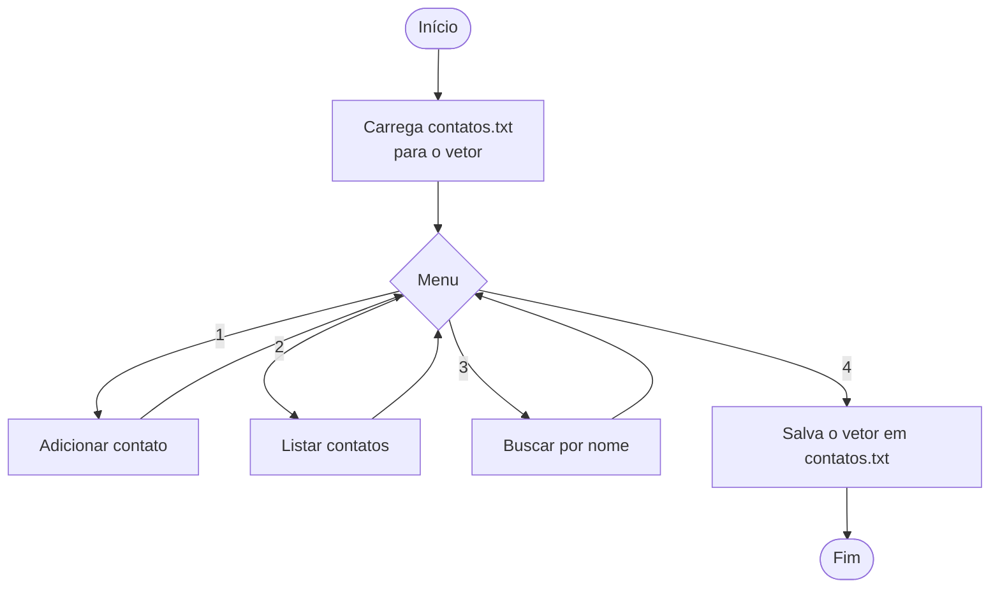

# 📒 Agenda de Contatos em C

Sistema de gerenciamento de contatos que roda no terminal, escrito em **C puro**, sem bibliotecas externas.
Cadastre, liste e busque contatos; tudo fica salvo em um arquivo de texto e é carregado de volta na próxima execução.


---

## 🎓 Contexto

Projeto desenvolvido em 2024 na disciplina de programação em C do **Bacharelado Interdisciplinar em Ciência e Tecnologia (BICT)** da **UNIFAL‑MG, campus Poços de Caldas**.

O objetivo era juntar, em um único programa útil, os principais fundamentos da linguagem: estruturas, vetores, ponteiros, funções e manipulação de arquivos.

---

## ✨ Funcionalidades

| Opção | O que faz |
|:---:|---|
| **1** | **Adicionar contato**: lê nome e telefone (nomes com espaço, como "Ana Souza", são aceitos) |
| **2** | **Listar contatos**: mostra todos os contatos cadastrados, numerados |
| **3** | **Buscar contato**: procura um contato pelo nome exato |
| **4** | **Sair**: grava todos os contatos em `contatos.txt` e encerra |

- **Persistência:** ao iniciar, o programa carrega os contatos salvos anteriormente.
- **Limite de segurança:** aceita até 100 contatos e avisa quando o limite é atingido.
- **Tratamento de erros:** avisa quando o arquivo não existe, quando não há contatos e quando a opção do menu é inválida.

---

## 🧠 Conceitos de C aplicados

| Conceito | Onde aparece |
|---|---|
| `struct` + `typedef` | Tipo `Contato`, com os campos `nome` e `telefone` |
| Vetor de estruturas | `Contato contatos[MAX_CONTATOS]` guarda a agenda na memória |
| Ponteiros | `int *numContatos` permite que as funções atualizem o contador do `main` |
| Modularização | Uma função para cada responsabilidade (adicionar, listar, buscar, salvar, carregar) |
| Arquivos | `fopen`, `fprintf`, `fscanf` e `fclose` para ler e gravar `contatos.txt` |
| Strings | `strcmp` na busca e `scanf(" %[^\n]")` para ler textos com espaço |
| Constantes | `#define` para limites e para o nome do arquivo, fáceis de ajustar |
| Controle de fluxo | Menu com `do-while` + `switch` |

---

## 🔄 Como o programa funciona



Os contatos ficam em memória enquanto o programa roda e são gravados no disco ao sair.
O arquivo usa um formato simples, uma linha por contato, com `;` separando os campos:

```text
Ana Souza;11999990000
Bruno Lima;11888887777
```

---

## 🚀 Como compilar e executar

Você precisa de um compilador C, como o **GCC** (no Windows, pelo [MinGW-w64](https://www.mingw-w64.org/) ou pelo Code::Blocks).

```bash
# Linux / macOS
gcc -Wall -o agenda agenda.c
./agenda
```

```bash
# Windows
gcc -Wall -o agenda.exe agenda.c
agenda.exe
```

O arquivo `contatos.txt` é criado na mesma pasta onde o programa é executado.

---

## 💻 Exemplo de uso

```text
Nenhum arquivo encontrado, criando um novo.

--- Sistema de Gerenciamento de Contatos ---
1. Adicionar contato
2. Listar contatos
3. Buscar contato
4. Sair
Escolha uma opcao: 1
Digite o nome do contato: Ana Souza
Digite o telefone do contato: 11999990000
Contato adicionado com sucesso!

Escolha uma opcao: 2

--- Lista de Contatos ---
Contato 1:
Nome: Ana Souza
Telefone: 11999990000

Escolha uma opcao: 3
Digite o nome do contato para buscar: Ana Souza
Contato encontrado:
Nome: Ana Souza
Telefone: 11999990000

Escolha uma opcao: 4
Contatos salvos com sucesso!
Saindo...
```

---

## 📁 Estrutura do projeto

```text
agenda-de-contatos/
├── agenda.c      # Código-fonte completo
├── README.md
└── .gitignore    # Ignora executáveis e o contatos.txt gerado
```

---

## 🛠️ Próximos passos

Ideias para evoluir o projeto:

- [ ] Editar e excluir contatos
- [ ] Busca parcial e sem diferenciar maiúsculas de minúsculas
- [ ] Validar o telefone (só números e tamanho correto)
- [ ] Ordenar a lista em ordem alfabética
- [ ] Usar alocação dinâmica (`malloc`/`realloc`) para remover o limite de 100 contatos
- [ ] Salvar a cada alteração, para não perder dados se o programa for fechado de repente

---

## 📄 Licença

Distribuído sob a licença MIT. Veja [LICENSE](LICENSE).

---

## 👤 Autor

**Mateus Patrício Pereira**
Estudante de Ciência da Computação na FIAP

[](https://www.linkedin.com/in/mateus-patricio-pereira/)
[](https://github.com/Matttpereira)
